# Atividade 30 - Migrations

Todas as etapas rodaram no banco de laboratório `aeroporto_lab`, uma cópia do `aeroporto` feita com `mysqldump`, para não mexer no banco do projeto. O projeto está em `atividade-30-migration/aeroporto/`.

Adaptações ao esquema real do projeto (diferente do enunciado):

- a tabela se chama `VOO` (não `voos`) e a coluna `origem` é `VARCHAR(45) NOT NULL`;
- a `CHECK chk_voo_rota (origem <> destino)` usa a coluna `origem`, então a migration 004 remove a constraint e a coluna na mesma instrução;
- na `001_baseline.sql` usei `DO 0;` no lugar de `SELECT 1;`, porque o `SELECT` deixa um resultado pendente no PDO do PHP 8.5 e o runner falha.

## 1. O runner de migrations

O `migrate.php` faz o seguinte: cria a tabela `schema_migrations`, lê os arquivos de `migrations/` em ordem, aplica só os que ainda não estão na tabela (`up`) e desfaz o último (`down`).

```
$ php migrate.php up
Aplicada: 001_baseline
```

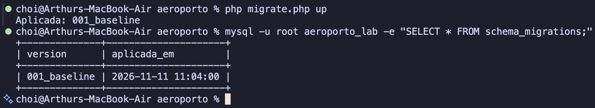


## 2. Primeira migration real (002)

```sql
-- up
ALTER TABLE VOO ADD COLUMN portao_embarque VARCHAR(5) NULL;
-- down
ALTER TABLE VOO DROP COLUMN portao_embarque;
```

Apliquei, conferi com `DESCRIBE VOO;` (evidência 002), desfiz (evidência 003) e apliquei de novo.

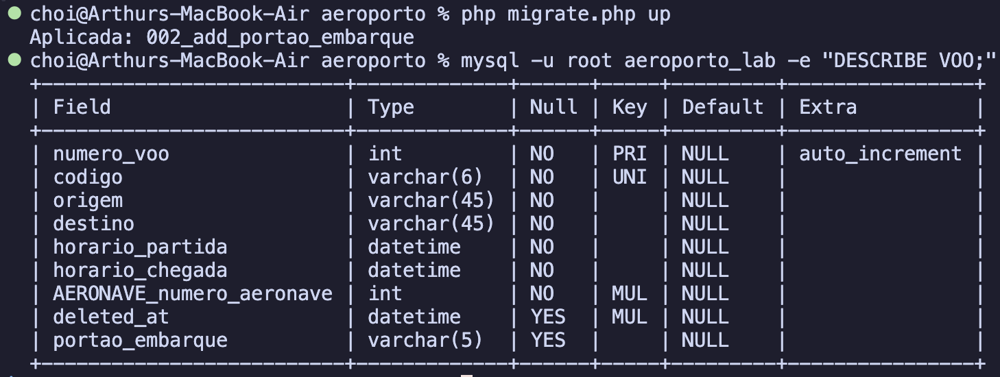
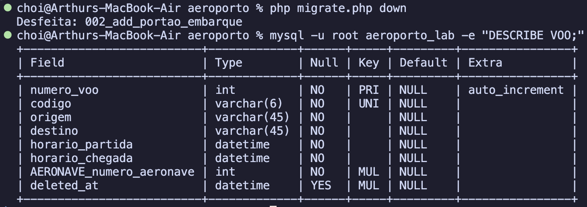


**Pergunta 1.**: se a coluna fosse `NOT NULL` sem valor padrão, o `INSERT INTO VOO (...)` do `Voo.php`, que não cita `portao_embarque`, falharia no MySQL em modo estrito. Ninguém conseguiria cadastrar voo a partir do instante da migration, e o código antigo quebraria em produção.

## 3. Expandir e contrair: `origem` → `aeroporto_origem`

### Passo 1 — expandir (003)

```sql
-- up
ALTER TABLE VOO ADD COLUMN aeroporto_origem VARCHAR(80) NULL;
-- down
ALTER TABLE VOO DROP COLUMN aeroporto_origem;
```

A coluna nova nasce `NULL`, então o código antigo, que só conhece `origem`, continua funcionando.

### Passo 2 — backfill em lotes

O `backfill_origem.php` copia `origem` para `aeroporto_origem` em lotes de 1000 linhas (`UPDATE ... WHERE aeroporto_origem IS NULL LIMIT 1000`), com pausa de 0,2 s entre os lotes. Saída:

```
Lote: 7 linhas
Lote: 0 linhas
```

Depois, `SELECT COUNT(*) FROM VOO WHERE aeroporto_origem IS NULL;` retornou **0** (checkpoint cumprido).

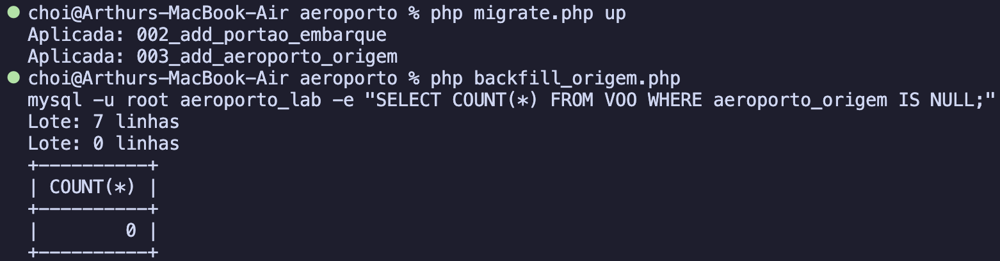

### Passo 3 — trocar o código

Em `models/Voo.php`, em duas etapas, nesta ordem.

**Etapa 1: gravar nos dois campos.** O `INSERT` e o `UPDATE` passaram a gravar `origem` e `aeroporto_origem` com o mesmo valor:

```php
$sql = "INSERT INTO VOO (codigo, origem, aeroporto_origem, destino, horario_partida, horario_chegada, AERONAVE_numero_aeronave)
        VALUES (:codigo, :origem, :aeroporto_origem, :destino, :horario_partida, :horario_chegada, :aeronave)";
...
    ':origem'           => $dados['origem'],
    ':aeroporto_origem' => $dados['origem'],
```

No `editar()`, o `SET` ganhou `v.aeroporto_origem = :aeroporto_origem`, com o mesmo parâmetro.

**Etapa 2: ler só o campo novo.** Os três `SELECT` (`buscarSeguro`, `listarExcluidos` e `consultarAtivos`) passaram a ler `aeroporto_origem`, com o alias `origem` para as views não precisarem mudar:

```php
$sql = "SELECT v.numero_voo, v.codigo, v.aeroporto_origem AS origem, v.destino, ...
```

Testei listar, criar, editar, excluir e restaurar voos pela aplicação.

Listagem de voos (lendo `aeroporto_origem`):

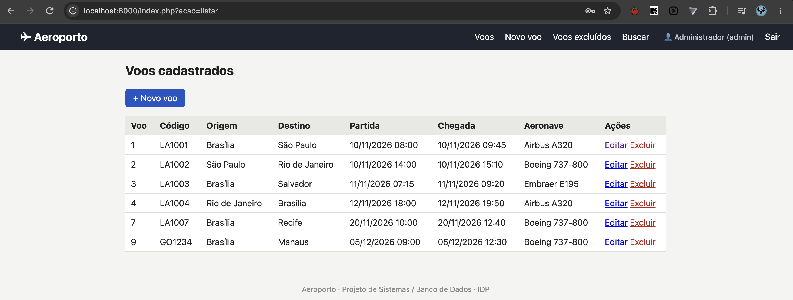

Voo `TS1234` criado pela aplicação (origem Curitiba):

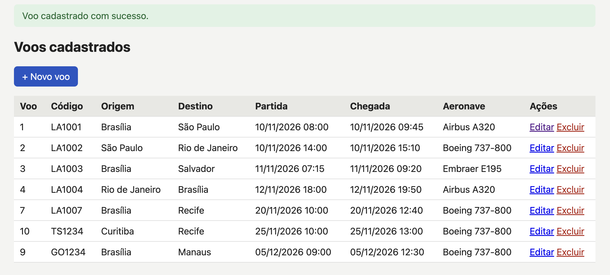

No banco, o voo novo tem os dois campos preenchidos (gravação dupla funcionando):

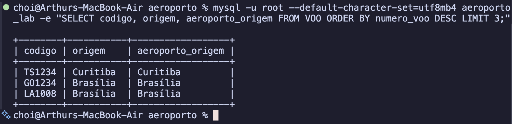

Edição do voo `TS1234` (origem alterada para Florianópolis, lida do campo novo):

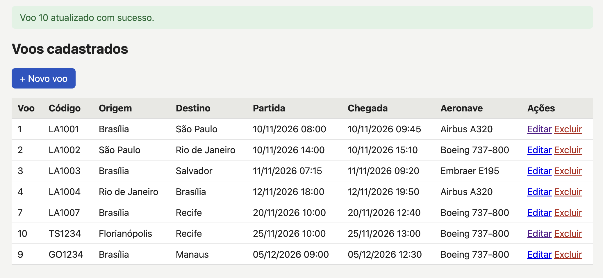

### Passo 4 — contrair (004)

```sql
-- up
ALTER TABLE VOO DROP CHECK chk_voo_rota, DROP COLUMN origem;
-- down
ALTER TABLE VOO ADD COLUMN origem VARCHAR(45) NULL, ADD CONSTRAINT chk_voo_rota CHECK (origem <> destino);
```

Só apliquei depois de o código novo estar funcionando. A coluna `origem` sumiu (`DESCRIBE VOO`) e a aplicação continuou listando e editando voos normalmente.

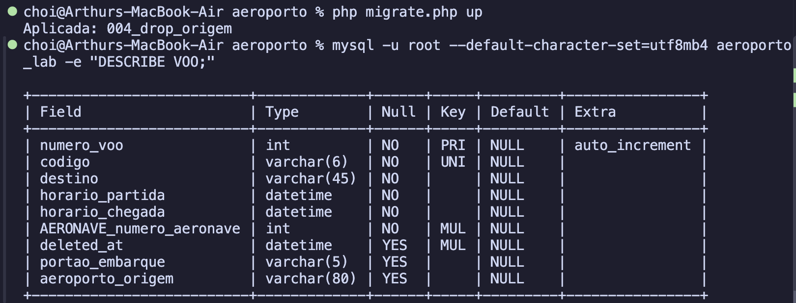

**Pergunta 2.** Executei `php migrate.php down` logo em seguida. A coluna `origem` voltou, mas com `NULL` em todos os voos:

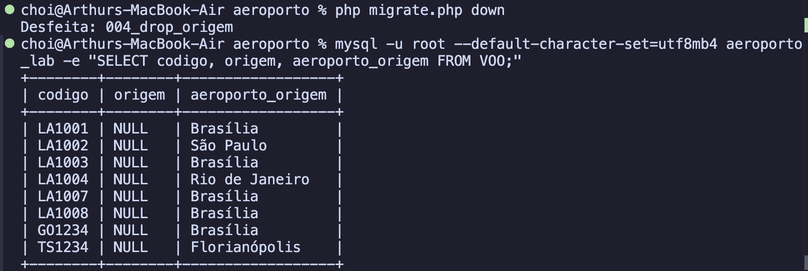

O `down` desfaz só a **estrutura** (recria a coluna e a CHECK), não os **dados** que o `DROP COLUMN` apagou. Para recuperá-los, eu restauraria o backup (`aeroporto_backup.sql`) ou, como a `aeroporto_origem` ainda existe com os mesmos valores, rodaria `UPDATE VOO SET origem = aeroporto_origem`. Depois do experimento, apliquei a 004 de novo com `php migrate.php up`.

## 4. Estado final

Tabela `schema_migrations` depois de aplicar tudo:

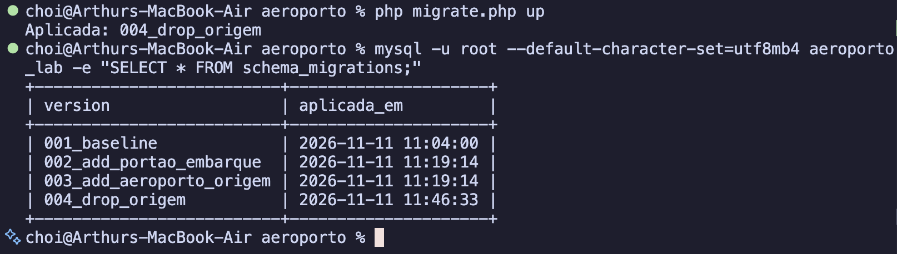

## 5. E se houvesse réplicas?

1. **Lag.** Um `UPDATE` sem `LIMIT` em uma tabela de 5 milhões de voos vira uma única transação gigante. No primário, ela segura locks nas linhas por muito tempo e gera um log enorme. As réplicas reaplicam essa mesma transação inteira, ficam atrasadas (lag) e passam a servir dados velhos. Em lotes de 1000 linhas com pausa, as réplicas acompanham o ritmo.
2. **Ordem.** O passo 3 vem depois do 1 porque o código novo só funciona se `aeroporto_origem` já existir. Vem antes do 4 porque o `DROP COLUMN origem` quebraria o código antigo, que ainda lê e grava `origem`, e durante o deploy ainda há instâncias antigas rodando.
3. **Imutabilidade.** A `002` já foi aplicada e registrada em `schema_migrations` nos outros ambientes. Editar o arquivo não a reexecuta, então cada ambiente ficaria com um tamanho diferente. O certo é criar uma nova migration, por exemplo `005_aumenta_portao_embarque.sql`, com `ALTER TABLE VOO MODIFY COLUMN portao_embarque VARCHAR(10) NULL;` no `up` e a volta para `VARCHAR(5)` no `down`.
4. **Backup.** O passo 4 (contrair): o `DROP COLUMN` apaga os dados da coluna, e o `down` recria a coluna vazia. Sem backup, ou sem a coluna nova já preenchida, não há como recuperar.

## 6. Arquivos entregues

`migrate.php`, `migrations/` (001 a 004), `backfill_origem.php`, `codigo/Voo.php` (model alterado no passo 3), capturas em `imagens-evidencias/` e este relatório, que também traz as respostas das perguntas 1 e 2 e da Parte 4.
